---
## Author
author:
  name: Арбаова Варвара Петровна
  email: 1132236020@rudn.ru
  affiliation:
    - name: Российский университет дружбы народов
      country: Российская Федерация
      postal-code: 117198
      city: Москва
      address: ул. Миклухо-Маклая, д. 6
## Title
title: Презентация по лабораторной работе №5
subtitle: Компьютерный практикум по статистическому анализу
license: CC BY
date: today
date-format: "YYYY-MM-DD" # Example: 2025-09-06

---

# Информация

## Докладчик

:::::::::::::: {.columns align=center}
::: {.column width="70%"}

  * Арбатова Варвара Петровна
  * студентка
  * Российский университет дружбы народов им. П. Лумумбы
  * [1132236020@rudn.ru](mailto:1132236020@rudn.ru)
  * <https://vparbatova.github.io/ru/>

:::
::::::::::::::

# Вводная часть

## Актуальность

- Визуализация данных — неотъемлемая часть научных исследований.
- `Plots.jl` — единый синтаксис и переключение между бэкендами (`GR`, `PyPlot`, `PlotlyJS`, `UnicodePlots`).
- Освоение инструментария необходимо для работы с экспериментальными данными и подготовки публикаций.

## Цель и задачи

- **Цель:** освоить синтаксис языка Julia для построения графиков.
- **Задачи:**
  - Воспроизвести примеры разделов 5.2.1–5.2.14 методички.
  - Выполнить задания 5.4.1–5.4.11.
  - Для каждого графика задать подписи осей, легенду и заголовок.
  - Оформить отчёт в формате Quarto Markdown.

## Материалы и методы

- **Оборудование:** персональный компьютер (Windows).
- **ПО:** Julia 1.10+, `Plots`, `PyPlot`, `PlotlyJS`, `UnicodePlots`, `Statistics`, `Distributions`, `FreeType`, `FileIO`.
- **Сборка:** `Literate.jl` (генерация `.qmd`) + Quarto.
- **Headless-режим:** `ENV["GKSwstype"] = "100"` для GR без дисплея.
- **Аппроксимация:** МНК через `A \ y`.
- **Погрешности:** $1.96 \cdot s / \sqrt{n}$ (95%-й интервал).

# Результаты: раздел 5.2

## 5.2.1. График функции $f(x)$ (GR)

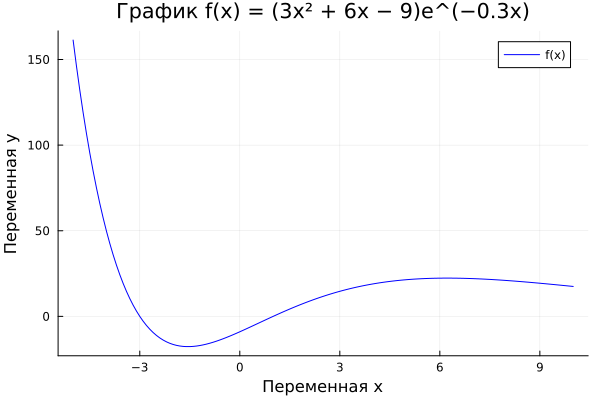{width=70%}

```julia
f(x) = (3x.^2 .+ 6x .- 9) .* exp.(-0.3x)
x = collect(range(-5, 10, length=151))
gr()
plot(x, f(x), title="График f(x)", xlabel="x", ylabel="y",
     color="blue", label="f(x)", legend=:topright)
```

::: notes
- По умолчанию `GR` — быстрый и совместим с GIF.
:::

## 5.2.1. График функции $f(x)$ (PyPlot)

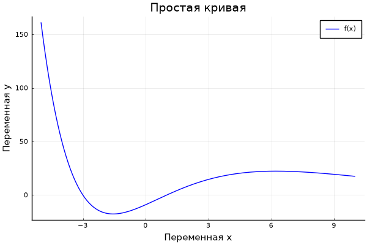{width=70%}

```julia
pyplot()
plot(x, f(x), title="Простая кривая", xlabel="Переменная x",
     ylabel="Переменная y", color="blue", label="f(x)")
```

::: notes
- `PyPlot` корректно отображает кириллицу в подписях.
:::

## 5.2.2. $\sin(x)$ и ряд Тейлора

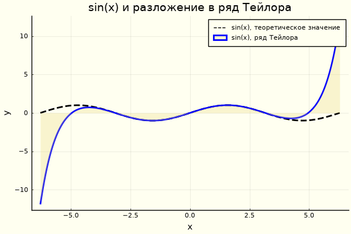{width=75%}

```julia
sin_theor(x)  = sin(x)
sin_taylor(x) = sum((-1)^i * x^(2i+1) / factorial(2i+1) for i in 0:4)
plot(sin_theor, -2π, 2π, label="sin(x)", line=(:black, 1.0, 2, :dash))
plot!(sin_taylor, -2π, 2π, label="ряд Тейлора", line=(:blue, 2.0),
      fillrange=0, fillalpha=0.3, fillcolor=:lightgoldenrod)
```

::: notes
- Усечённый ряд хорошо совпадает вблизи нуля и расходится на краях.
:::

## 5.2.3. Точечные графики

:::::::::::::: {.columns}
::: {.column width="33%"}
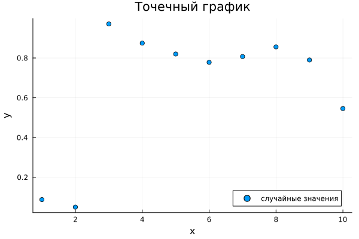{width=100%}
:::
::: {.column width="33%"}
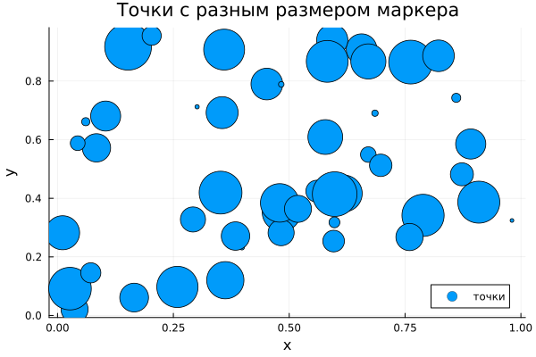{width=100%}
:::
::: {.column width="33%"}
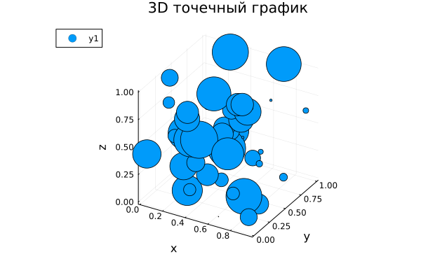{width=100%}
:::
::::::::::::::

```julia
scatter(range(1,10,length=10), rand(10))                 # простой
scatter(rand(50), rand(50), markersize=rand(50).*30)     # размер
scatter(rand(50), rand(50), rand(50), markersize=rand(50).*30)  # 3D
```

## 5.2.4. Аппроксимация данных

:::::::::::::: {.columns}
::: {.column width="50%"}
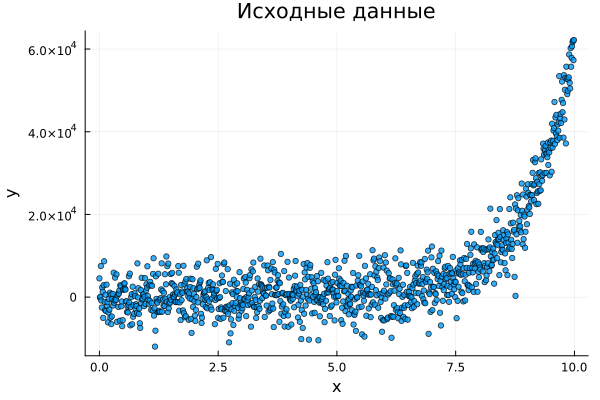{width=100%}
:::
::: {.column width="50%"}
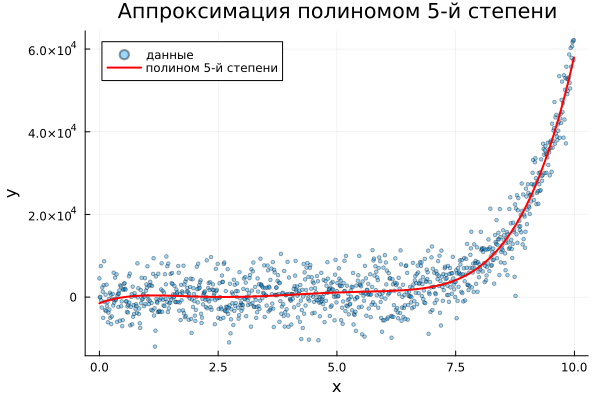{width=100%}
:::
::::::::::::::

```julia
x = collect(0:0.01:9.99)
y = exp.(ones(1000) .+ x) .+ 4000 .* randn(1000)
A = [ones(1000) x x.^2 x.^3 x.^4 x.^5]
c = A \ y
f = c[1].*ones(1000) .+ c[2].*x .+ ... .+ c[6].*x.^5
```

## 5.2.5. Две оси ординат

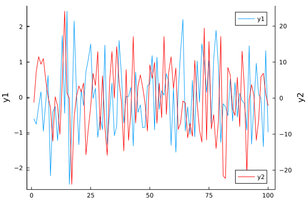{width=70%}

```julia
p = plot(randn(100), ylabel="y1", leg=:topright, grid=:off)
p_twin = twinx(p)
plot!(p_twin, randn(100)*10, c=:red, ylabel="y2", leg=:bottomright)
```

::: notes
- `twinx()` решает проблему разных масштабов.
:::

## 5.2.6. Полярные координаты

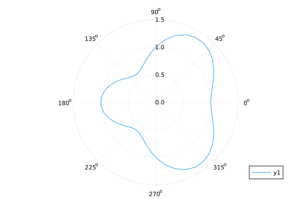{width=55%}

```julia
r(θ) = 1 + cos(θ) * sin(θ)^2
θ = range(0, stop=2π, length=50)
plot(θ, r.(θ), proj=:polar, lims=(0,1.5))
```

## 5.2.7. Параметрические графики

:::::::::::::: {.columns}
::: {.column width="50%"}
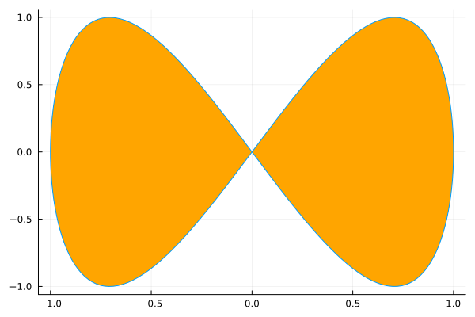{width=100%}
:::
::: {.column width="50%"}
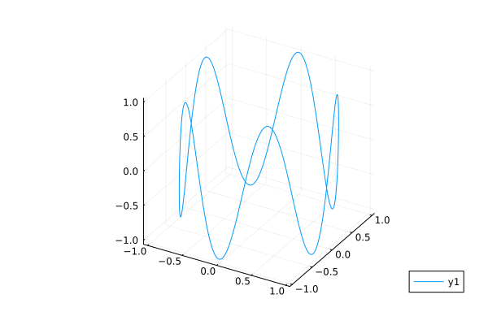{width=100%}
:::
::::::::::::::

```julia
x(t) = sin(t); y(t) = sin(2t)
plot(x, y, 0, 2π, leg=false, fill=(0,:orange))
t = range(0, stop=10, length=1000)
plot(cos.(t), sin.(t), sin.(5 .* t))
```

## 5.2.8. Поверхности

:::::::::::::: {.columns}
::: {.column width="33%"}
{width=100%}
:::
::: {.column width="33%"}
{width=100%}
:::
::: {.column width="33%"}
{width=100%}
:::
::::::::::::::

```julia
X = Y = range(-10, stop=10, length=40)
f_surf(x, y) = x^2 + y^2
surface(X, Y, f_surf)
plot(X, Y, f_surf, st=:surface)
plot(X, Y, f_surf, st=:surface, camera=(-30, 30))
```

## 5.2.9. Линии уровня

:::::::::::::: {.columns}
::: {.column width="50%"}
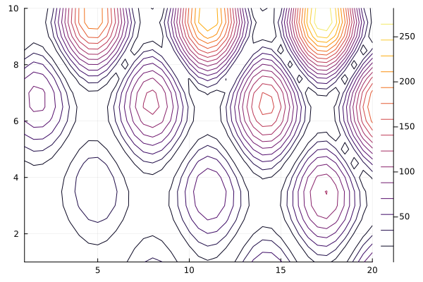{width=100%}
:::
::: {.column width="50%"}
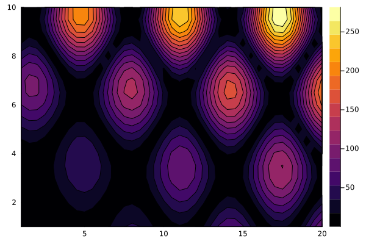{width=100%}
:::
::::::::::::::

```julia
x = 1:0.5:20; y = 1:0.5:10
g(x, y) = (3x .+ y.^2) .* abs.(sin.(x) .+ cos.(y))
contour(x, y, g)
contour(x, y, g, fill=true)
```

## 5.2.10. Векторное поле

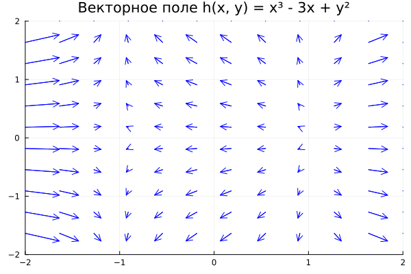{width=65%}

```julia
x_g = y_g = range(-2, stop=2, length=12)
dh(x, y) = ((3x^2 - 3)/25, (2y)/25)
XG = repeat(collect(x_g), inner=length(y_g))
YG = repeat(collect(y_g), outer=length(x_g))
UG = [dh(XG[i], YG[i])[1] for i in 1:length(XG)]
VG = [dh(XG[i], YG[i])[2] for i in 1:length(YG)]
quiver(XG, YG, quiver=(UG, VG), c=:blue)
```

## 5.2.11. Анимации (GIF)

:::::::::::::: {.columns}
::: {.column width="50%"}

```julia
anim = @animate for i in range(0, stop=2π, length=50)
    surface(X, Y, (x,y) -> sin(x + 10sin(i)) + cos(y))
end
gif(anim, "surface_anim.gif", fps=15)
```
:::
::: {.column width="50%"}

```julia
r_val = 1; k_val = 3; n_val = 100
θ = collect(0 : 2π/n_val : 2π + 2π/n_val)
anim = @animate for i in 1:n_val
    t = θ[1:i]
    x = r_val*(k_val-1)*cos.(t) .+ r_val*cos.((k_val-1)*t)
    y = r_val*(k_val-1)*sin.(t) .- r_val*sin.((k_val-1)*t)
    plot(x, y, xlims=(-4,4), ylims=(-4,4), aspect_ratio=1)
end
gif(anim, "hypocycloid.gif", fps=30)
```
:::
::::::::::::::

## 5.2.12. Графики с погрешностями

:::::::::::::: {.columns}
::: {.column width="33%"}
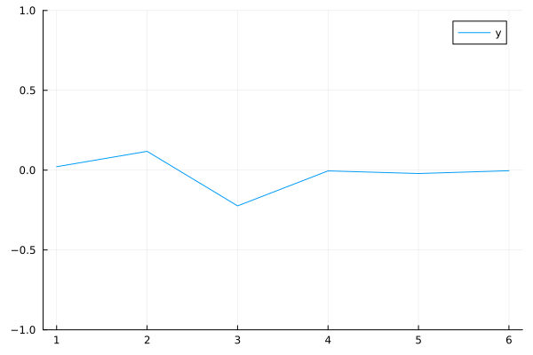{width=100%}
:::
::: {.column width="33%"}
{width=100%}
:::
::: {.column width="33%"}
{width=100%}
:::
::::::::::::::

```julia
sds = [1, 1/2, 1/4, 1/8, 1/16, 1/32]
y = [mean(sd*randn(10)) for sd in sds]
errs = 1.96 .* sds ./ sqrt(10)
plot(y, ylims=(-1,1)); plot(y, err=errs); plot(y, ribbon=errs, fill=:cyan)
```

## 5.2.13. Гистограммы (`Distributions`)

:::::::::::::: {.columns}
::: {.column width="33%"}
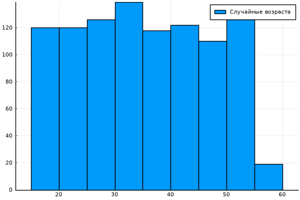{width=100%}
:::
::: {.column width="33%"}
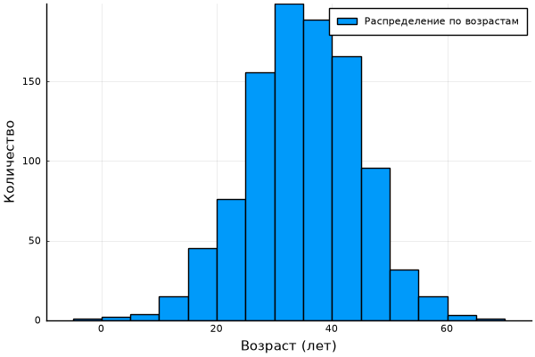{width=100%}
:::
::: {.column width="33%"}
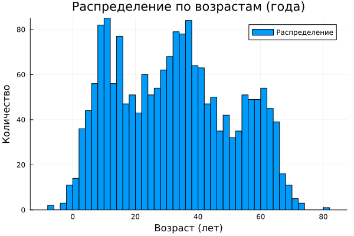{width=100%}
:::
::::::::::::::

```julia
histogram(rand(15:55, 1000))
d = Normal(35.0, 10.0); histogram(rand(d, 1000))
d1=Normal(10,5); d2=Normal(35,10); d3=Normal(60,5)
histogram(vcat(rand(d1,500), rand(d2,1000), rand(d3,334)), bins=50)
```

## 5.2.14. Подграфики (`layout`)

:::::::::::::: {.columns}
::: {.column width="50%"}
{width=100%}
:::
::: {.column width="50%"}
![`grid(4,1,heights=[...])`](image/5_2_14_layout_heights.png){width=100%}
:::
::::::::::::::

```julia
x = range(-2, 2, length=10); y = rand(10, 4)
plot(x, y, layout=(4,1))
plot(x, y, layout=grid(4, 1, heights=[0.2, 0.3, 0.4, 0.1]))
p1=plot(x,y); p2=scatter(x,y); p3=plot(x,y[:,1:2],lw=2); p4=histogram(x,y)
plot(p1,p2,p3,p4, layout=(2,2), legend=false)
```

# Результаты: задания 5.4

## Задания 1–2. Все типы графиков для $y = \sin x$

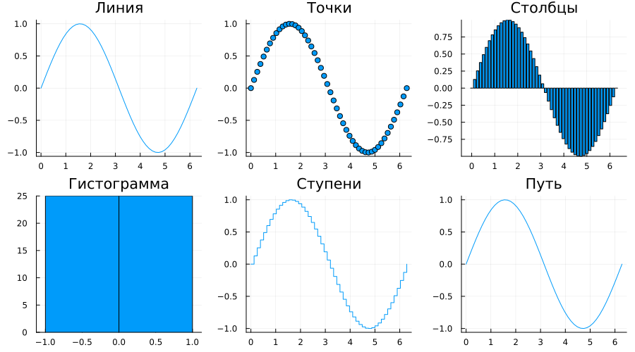{width=85%}

```julia
x = range(0, 2π, length=50); y = sin.(x)
plot(layout=(2,3), legend=false)
plot!(p[1], x, y, seriestype=:line,    title="Линия")
plot!(p[2], x, y, seriestype=:scatter, title="Точки")
plot!(p[3], x, y, seriestype=:bar,     title="Столбцы")
plot!(p[4], x, y, seriestype=:histogram, title="Гистограмма")
plot!(p[5], x, y, seriestype=:step,    title="Ступени")
plot!(p[6], x, y, seriestype=:path,    title="Путь")
```

## Задание 3. $y = \pi x^2 \ln x$

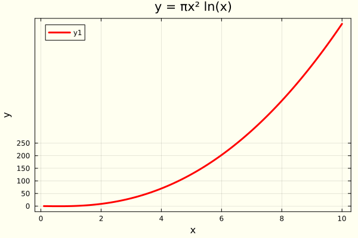{width=65%}

```julia
x = range(0.1, 10, length=100)
y = π .* x.^2 .* log.(x)
plot(x, y, title="y = πx² ln(x)", xlabel="x", ylabel="y",
     line=:red, linewidth=3, framestyle=:box,
     background_color=:ivory,
     xticks=[0,2,4,6,8,10], yticks=[0,50,100,150,200,250])
```

::: notes
- Красная линия, светлый фон, рамка, ручные деления осей.
:::

## Задание 4. $y = x^3 - 3x$ в четырёх подграфиках

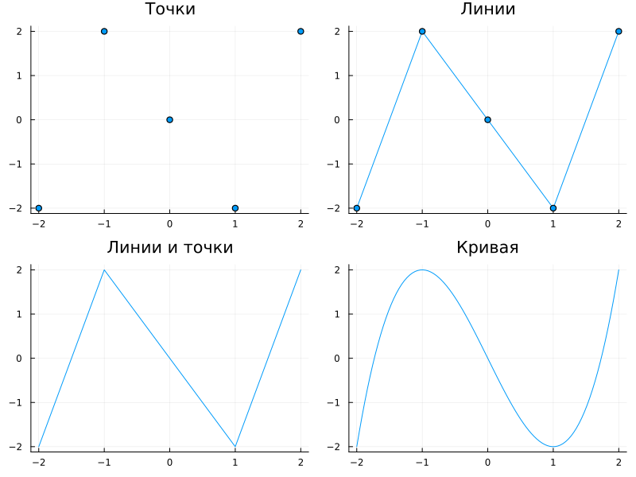{width=75%}

```julia
x = [-2, -1, 0, 1, 2]; y = x.^3 .- 3 .* x
xc = range(-2, 2, length=100); yc = xc.^3 .- 3 .* xc
plot(layout=(2,2), legend=false)
scatter!(p[1], x, y, title="Точки")
plot!(p[2], x, y, title="Линии", marker=:circle)
plot!(p[3], x, y, title="Линии и точки", seriestype=[:line :scatter])
plot!(p[4], xc, yc, title="Кривая")
```

::: notes
- Файл сохранён как `figure_familiya.png` — как требует задание.
:::

## Задание 5. Две функции: одна ось vs две оси

:::::::::::::: {.columns}
::: {.column width="50%"}
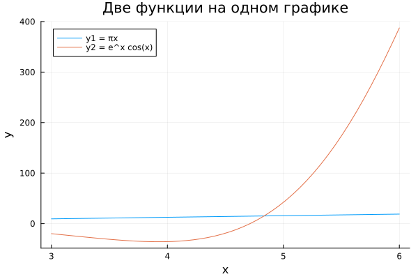{width=100%}
:::
::: {.column width="50%"}
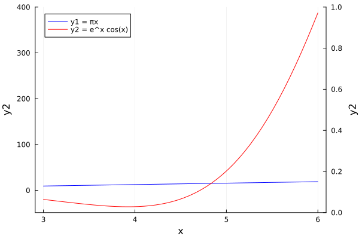{width=100%}
:::
::::::::::::::

```julia
x = range(3, 6, length=50)
y1 = π .* x; y2 = exp.(x) .* cos.(x)
plot(x, y1, label="y1 = πx"); plot!(x, y2, label="y2 = e^x cos(x)")  # недостаток: масштабы
plot(x, y1, label="y1 = πx", line=:blue); twinx()
plot!(x, y2, label="y2 = e^x cos(x)", line=:red)
```

::: notes
- **Недостаток одной оси:** $y_1$ выглядит почти горизонтальной линией.
- Решение — `twinx()`.
:::

## Задание 6. Экспериментальные данные с погрешностью

{width=60%}

```julia
x = 1:10
y = 5 .* x .+ randn(10) .* 2
err = rand(10) .* 1.5
scatter(x, y, yerror=err, label="Экспериментальные данные",
        xlabel="Попытка", ylabel="Результат",
        title="Данные с погрешностью")
```

## Задание 7. Точечный график случайных данных

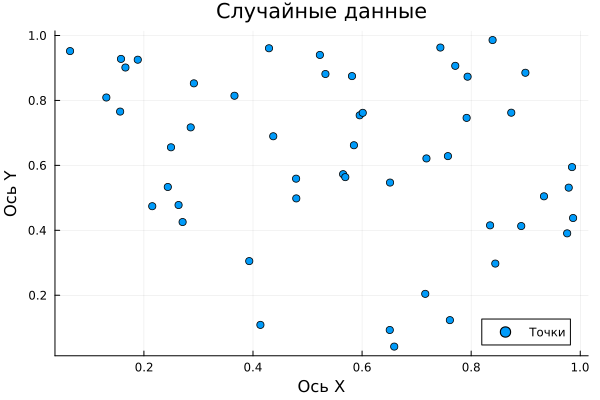{width=60%}

```julia
scatter(rand(50), rand(50), title="Случайные данные",
        xlabel="Ось X", ylabel="Ось Y", label="Точки")
```

## Задание 8. 3D точечный график случайных данных

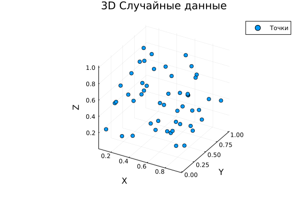{width=60%}

```julia
scatter(rand(50), rand(50), rand(50), title="3D Случайные данные",
        xlabel="X", ylabel="Y", zlabel="Z", label="Точки")
```

## Задание 9. Анимация синусоиды

```julia
x = range(0, 2π, length=100)
anim = @animate for t in range(0, 2π, length=50)
    plot(x, sin.(x .+ t), ylims=(-1.5,1.5),
         label="sin(x+t)", title="Анимация синусоиды")
end
gif(anim, "5_4_task_9_sine_anim.gif", fps=20)
```

## Задание 10. Анимация гипоциклоиды

```julia
function create_hypocycloid_gif(k_vals, filename)
    r = 1.0; t = range(0, 2π, length=100)
    anim = @animate for k in k_vals
        x = r*(k-1)*cos.(t) .+ r*cos.((k-1)*t)
        y = r*(k-1)*sin.(t) .- r*sin.((k-1)*t)
        plot(x, y, aspect_ratio=1, title="Гипоциклоида (k=$k)")
    end
    gif(anim, filename, fps=10)
end
create_hypocycloid_gif(range(2.0, 2.5, length=20),  "hypo_pos.gif")
create_hypocycloid_gif(range(-2.0,-2.5, length=20), "hypo_neg.gif")
```

## Задание 11. Анимация эпициклоиды

```julia
function create_epicycloid_gif(k_vals, filename)
    r = 1.0; t = range(0, 2π, length=100)
    anim = @animate for k in k_vals
        x = r*(k+1)*cos.(t) .- r*cos.((k+1)*t)
        y = r*(k+1)*sin.(t) .- r*sin.((k+1)*t)
        plot(x, y, aspect_ratio=1, title="Эпициклоида (k=$k)")
    end
    gif(anim, filename, fps=10)
end
create_epicycloid_gif(range(2.0, 2.5, length=20),  "epi_pos.gif")
create_epicycloid_gif(range(-2.0,-2.5, length=20), "epi_neg.gif")
```

# Заключение

## Главный вывод

- Освоен синтаксис `Plots.jl`: воспроизведены разделы 5.2.1–5.2.14 и выполнены задания 5.4.1–5.4.11.
- Все графики снабжены подписями осей, легендой и заголовком.
- Отчёт собран в формате Quarto Markdown с автоматическим включением листинга и изображений.
