---
## Author
author:
  name: Арбатова Варвара Петровна
  email: 1132236020@rudn.ru
  affiliation:
    - name: Российский университет дружбы народов
      country: Российская Федерация
      postal-code: 117198
      city: Москва
      address: ул. Миклухо-Маклая, д. 6

## Title
title: "Отчёт по лабораторной работе №5"
subtitle: "Компьютерный практикум по статистическому анализу"
license: "CC BY"
abstract: |
  В данном отчёте представлены результаты выполнения лабораторной работы по теме "Построение графиков"

  Описаны использованные методы, полученные экспериментальные данные и их анализ.

  Сделаны выводы о достижении поставленной цели.
keywords: [лабораторная работа, шаблон, Markdown, Pandoc]
---

# Введение

## Актуальность

Визуализация данных — неотъемлемая часть научных и инженерных
исследований. Язык Julia предоставляет развитую экосистему для
построения графиков, центральным элементом которой является пакет
`Plots.jl`. Он позволяет единообразно описывать графики и при этом
переключаться между разными графическими бэкендами (`GR`, `PyPlot`,
`PlotlyJS`, `UnicodePlots`) без изменения пользовательского кода.
Освоение этого инструментария необходимо для дальнейшей работы с
экспериментальными данными, численными расчётами и подготовкой
публикаций.

## Цель работы

Основная цель работы — освоить синтаксис языка Julia для построения
графиков.

## Задачи

Для достижения цели необходимо:

1. Установить и подключить пакеты `Plots`, `PyPlot`, `PlotlyJS`,
   `UnicodePlots`, `Statistics`, `Distributions`.
2. Воспроизвести примеры из раздела 5.2 методических указаний:
   графики функций, точечные графики, 3D-графики, поверхности,
   линии уровня, векторные поля, гистограммы, графики с
   погрешностями, подграфики (`layout`), анимации (GIF).
3. Для каждого графика задать подписи осей, легенду и заголовок.
4. Выполнить задания для самостоятельного выполнения (раздел 5.4).
5. Оформить отчёт в формате Quarto Markdown (`.qmd`), встроив
   сгенерированный из `lab5.jl` markdown-файл и все полученные
   изображения с подписями и ссылками в тексте.

## Объект и предмет исследования

**Объект:** система визуализации данных `Plots.jl` в языке Julia.
**Предмет:** синтаксис и возможности пакета при построении различных
типов графиков (2D, 3D, анимации, подграфики).

## Методы исследования

- Изучение методических указаний и документации `Plots.jl`.
- Программный эксперимент: написание скрипта `lab5.jl`, запуск,
  сохранение результатов в `image/`.
- Сравнение поведения разных бэкендов (`GR`, `PyPlot`, `PlotlyJS`).
- Анализ полученных изображений и формулировка выводов.

## Схема выполнения работы

На рис. -@fig-flowchart представлена общая последовательность действий
при выполнении работы.

::: {#fig-flowchart}

```{mermaid}
%%| fig-width: 100%
graph TD
    A@{ shape: circle, label: "Начало" } --> B[Установить и подключить пакеты]
    B --> C[Написать literate-скрипт lab5.jl]
    C --> D[Запустить tangle.jl: получить markdown/lab5/lab5.qmd]
    D --> E[Собрать report.qmd: инклюд lab5.qmd и изображений]
    E --> F[Проверить графики, подписи, ссылки]
    F --> G[Сделать релиз git]
    G --> J@{ shape: dbl-circ, label: "Конец" }
```

Блок-схема выполнения лабораторной работы

:::

# Теоретическая часть

## Пакеты для работы с графиками в Julia

Julia поддерживает несколько пакетов для визуализации. Стандартным
является `Plots.jl` — высокоуровневый интерфейс, который
«делегирует» отрисовку выбранному бэкенду:

| Бэкенд          | Назначение                                                        |
|-----------------|-------------------------------------------------------------------|
| `GR`            | Быстрый, по умолчанию; хорош для 2D/3D и сохранения в PNG/GIF     |
| `PyPlot`        | Обёртка над Matplotlib; поддержка кириллицы в подписях            |
| `PlotlyJS`      | Интерактивные графики в браузере; для `savefig` нужен Kaleido     |
| `UnicodePlots`  | Графики в терминале (без дисплея)                                 |

Переключение бэкенда выполняется одной командой: `gr()`, `pyplot()`,
`plotlyjs()` и т.д. После этого все вызовы `plot`, `scatter`,
`surface` и т.п. используют выбранный бэкенд.

## Построение графика функции

Для построения графика функции $f(x)$ необходимо задать массивы
значений $x$ и $y = f(x)$. В Julia это делается поэлементными
операциями (точка перед оператором):

```julia
f(x) = (3x.^2 .+ 6x .- 9) .* exp.(-0.3x)
x = collect(range(-5, 10, length=151))
y = f(x)
plot(x, y, title="...", xlabel="x", ylabel="y", color="blue")
```

## Аппроксимация данных

Пусть в точках $x_0, x_1, \ldots, x_N$ известны значения функции
$y_0, y_1, \ldots, y_N$. Требуется найти коэффициенты многочлена
$F(x) = a_0 + a_1 x + \ldots + a_k x^k$ ($k < N$), минимизирующие
сумму квадратов отклонений:

$$
S = \sum_{i=0}^{N}\bigl[y_i - F(x_i, a_0, \ldots, a_k)\bigr]^2 \to \min.
$$

Задача сводится к решению системы $A\vec{x} = \vec{y}$, где $A$ —
матрица коэффициентов (столбцы — степени $x$), а $\vec{y}$ — вектор
наблюдений. В Julia это решается оператором `\` (обратный слэш):

```julia
A = [ones(1000) x x.^2 x.^3 x.^4 x.^5]
c = A \ y
```

## Две оси ординат

Для отображения двух траекторий с существенно разными масштабами
используется функция `twinx()`: она создаёт вторую ось $y$,
привязанную к тому же графику. После этого `plot!` рисует данные
уже на новой оси.

## Параметрические графики и анимации

Параметрическая кривая задаётся уравнениями $x = x(t)$, $y = y(t)$,
$t \in [t_0, t_1]$. В `Plots.jl` её можно построить как
`plot(x, y, t0, t1)`. Для GIF-анимации используется макрос `@animate`
и функция `gif(anim, "file.gif"; fps=...)`.

Гипоциклоида — кривая, которую описывает точка окружности радиуса $r$,
катящейся по внутренней стороне окружности радиуса $R = rk$:

$$
\begin{cases}
x(t) = r(k-1)\cos t + r\cos\bigl((k-1)t\bigr),\\
y(t) = r(k-1)\sin t - r\sin\bigl((k-1)t\bigr).
\end{cases}
$$

Эпициклоида — аналогичная кривая при качении по внешней стороне:

$$
\begin{cases}
x(t) = r(k+1)\cos t - r\cos\bigl((k+1)t\bigr),\\
y(t) = r(k+1)\sin t - r\sin\bigl((k+1)t\bigr).
\end{cases}
$$

# Материалы и методы

- **Оборудование:** персональный компьютер (Linux).
- **Программное обеспечение:** Julia 1.10+, пакеты `Plots`,
  `PyPlot`, `PlotlyJS`, `UnicodePlots`, `Statistics`, `Distributions`,
  `FreeType`, `FileIO`; система вёрстки Quarto; `Literate.jl`
  (генерация `.qmd` из literate-скрипта).
- **Настройка окружения:** в начале скрипта установлена переменная
  `ENV["GKSwstype"] = "100"` — это позволяет строить графики GR без
  дисплея (headless-режим).
- **Структура скрипта:** `lab5.jl` разбит на блоки, соответствующие
  разделам 5.2.1–5.2.14 методички и заданиям 5.4.1–5.4.11. Все
  результаты сохраняются в папку `image/`.
- **Обработка данных:** для аппроксимации использован метод
  наименьших квадратов (решение переопределённой системы `A \ y`);
  для гистограмм — пакет `Distributions` (нормальное распределение);
  для погрешностей — формула $1.96 \cdot s / \sqrt{n}$ (95%-й
  доверительный интервал).

# Выполнение лабораторной работы

Ниже приведён встроенный результат генерации `lab5.jl` в формат
Quarto Markdown (команда `julia tangle.jl scripts/lab5.jl`). Каждый
шаг сопровождается кодом, а изображения — подписями и ссылками.



# Результаты

В ходе работы получены следующие файлы (все — в папке `image/`).

## 5.2.1. График функции $f(x) = (3x^2 + 6x - 9)e^{-0.3x}$

На рис. -@fig-gr и -@fig-pyplot показаны графики, построенные
бэкендами `GR` и `PyPlot` соответственно. `PyPlot` корректно
отображает кириллицу в подписях осей и заголовке.

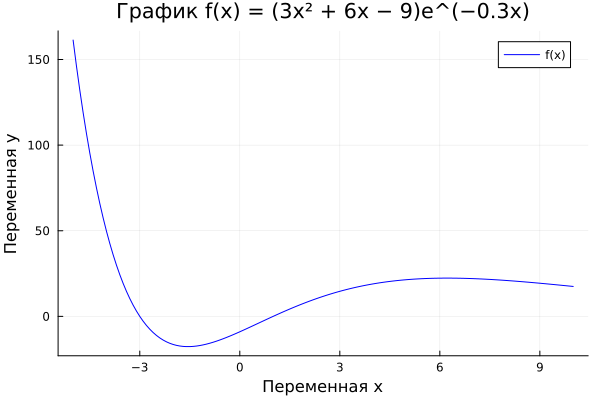{#fig-gr width=70%}

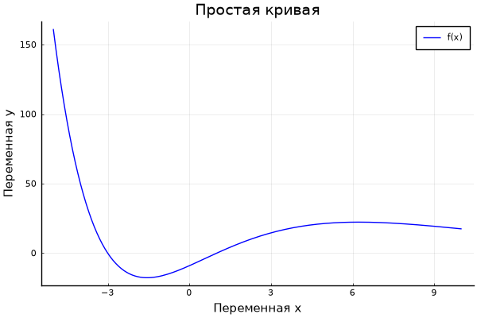{#fig-pyplot width=70%}

## 5.2.2. $\\sin(x)$ и его разложение в ряд Тейлора

На рис. -@fig-taylor показаны теоретическая кривая $\sin x$
(штриховая чёрная линия) и её приближение рядом Тейлора
(сплошная синяя линия с заливкой). Видно, что на отрезке
$[-2\pi, 2\pi]$ приближение пятого порядка хорошо совпадает с
теоретической кривой вблизи нуля и расходится на краях интервала —
это ожидаемое поведение усечённого ряда.

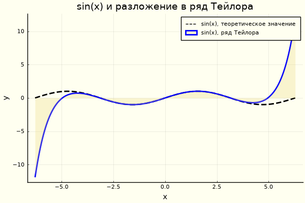{#fig-taylor width=80%}

## 5.2.3. Точечные графики

- Рис. -@fig-sc-simple — простой точечный график случайных значений.
- Рис. -@fig-sc-size — точечный график с кодированием размера маркера
  (размер пропорционален случайной величине).
- Рис. -@fig-sc-3d — трёхмерный точечный график.

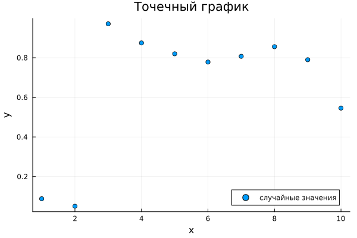{#fig-sc-simple width=65%}

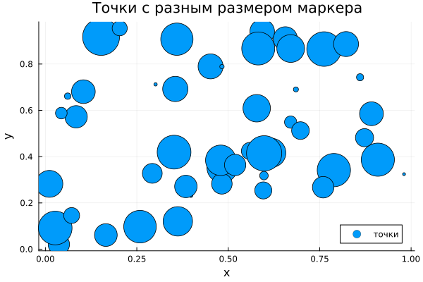{#fig-sc-size width=65%}

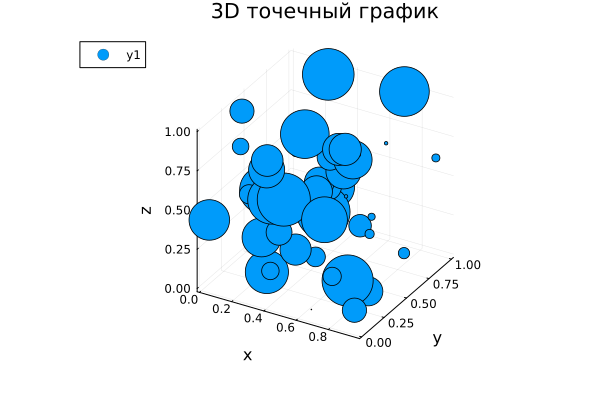{#fig-sc-3d width=65%}

## 5.2.4. Аппроксимация данных

На рис. -@fig-raw показаны «сырые» данные (экспоненциальная функция
с гауссовым шумом), на рис. -@fig-approx — аппроксимация полиномом
5-й степени, полученная решением системы $A\vec{x} = \vec{y}$.
Полином хорошо описывает общий тренд, но не воспроизводит шум —
это и есть смысл аппроксимации (сглаживание).

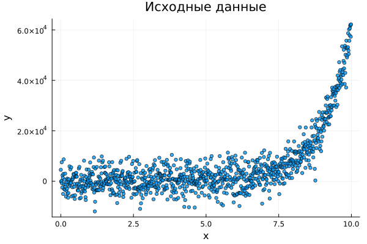{#fig-raw width=65%}

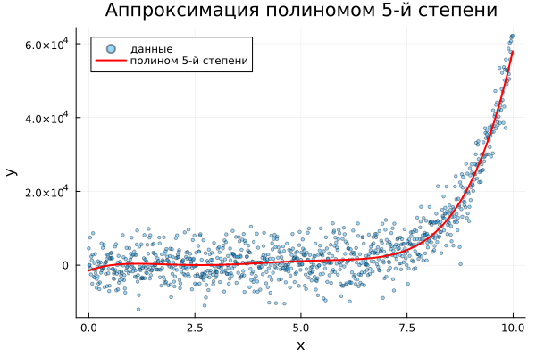{#fig-approx width=65%}

## 5.2.5. Две оси ординат

На рис. -@fig-twinx показаны две траектории с разными масштабами:
синяя — на левой оси, красная — на правой. Использован `twinx()`.

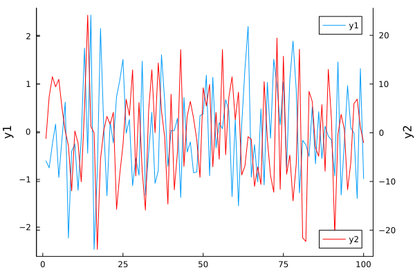{#fig-twinx width=70%}

## 5.2.6. Полярные координаты

На рис. -@fig-polar показан график функции $r(\theta) = 1 + \cos\theta\sin^2\theta$
в полярных координатах (`proj=:polar`).

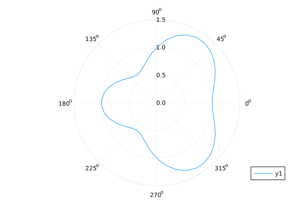{#fig-polar width=60%}

## 5.2.7. Параметрические графики

- Рис. -@fig-par2d — параметрическая кривая на плоскости
  $x(t)=\sin t$, $y(t)=\sin 2t$ (фигура Лиссажу).
- Рис. -@fig-par3d — параметрическая кривая в пространстве
  $x=\cos t$, $y=\sin t$, $z=\sin 5t$.

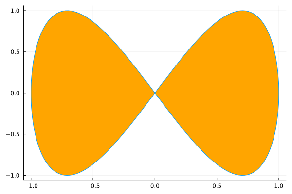{#fig-par2d width=60%}

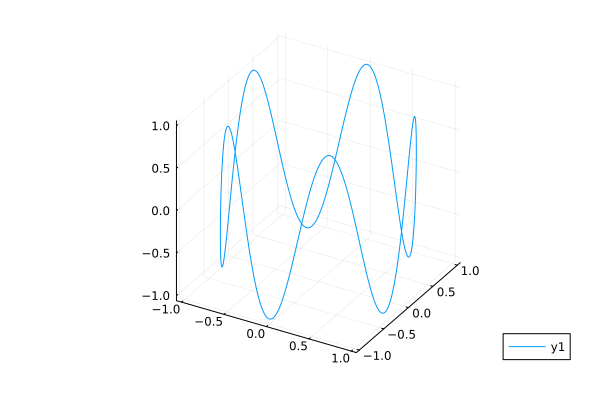{#fig-par3d width=70%}

## 5.2.8. Поверхности

На рис. -@fig-surf, -@fig-surf-plot и -@fig-surf-angle показана
поверхность $f(x,y) = x^2 + y^2$, построенная функциями `surface()`
и `plot(..., st=:surface)`, а также с изменённым углом обзора
(`camera=(-30, 30)`).

{#fig-surf width=65%}

{#fig-surf-plot width=65%}

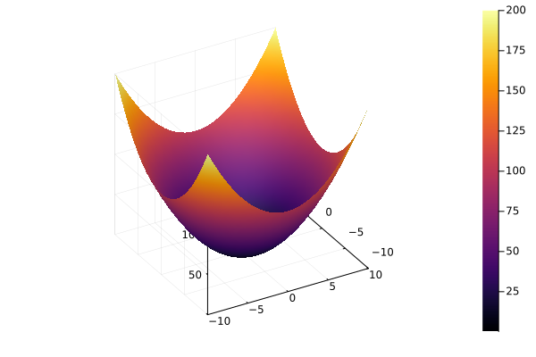{#fig-surf-angle width=65%}

## 5.2.9. Линии уровня

На рис. -@fig-contour и -@fig-contour-fill показаны линии уровня
функции $g(x,y) = (3x + y^2)\,|\sin x + \cos y|$ без заливки и с
заливкой (`fill=true`). Замкнутые контуры соответствуют локальным
экстремумам.

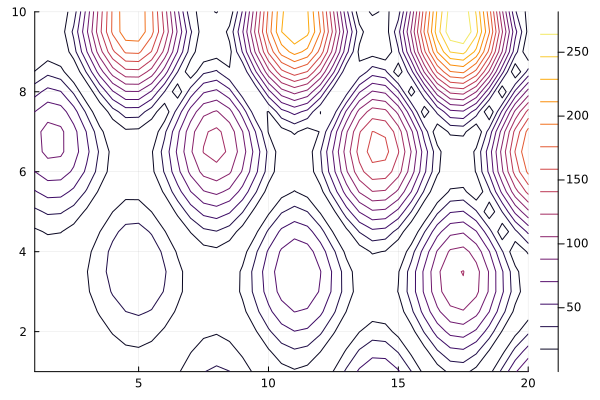{#fig-contour width=65%}

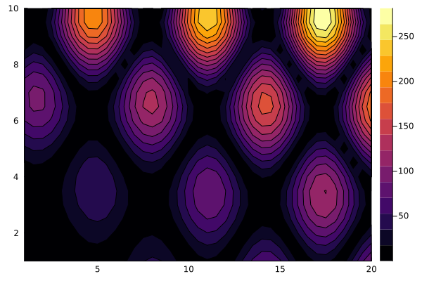{#fig-contour-fill width=65%}

## 5.2.10. Векторное поле

На рис. -@fig-quiver показано векторное поле градиента функции
$h(x,y) = x^3 - 3x + y^2$. Стрелки направлены в сторону
наибольшего роста функции; в точке $(1, 0)$ и $(-1, 0)$ видны
особенности (нули градиента) — седловые точки и минимумы.

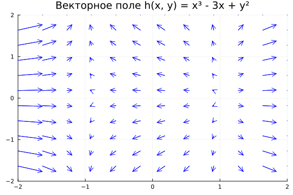{#fig-quiver width=65%}

## 5.2.11. Анимации

Выложены на rutube и VK-видео

## 5.2.12. Графики с погрешностями

На рис. -@fig-err-raw, -@fig-err-bar и -@fig-err-ribbon показаны
исходные значения $y$, график с планками погрешностей (`err=...`) и
график с «лентой» доверительного интервала (`ribbon=...`,
`fill=:cyan`). Погрешность рассчитана как $1.96\,s/\sqrt{n}$.

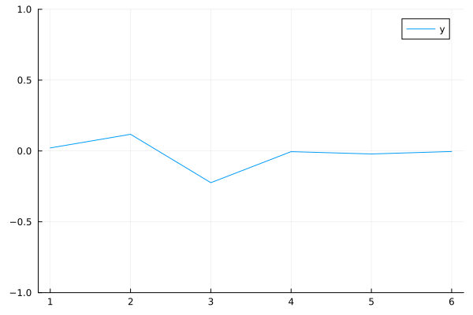{#fig-err-raw width=60%}

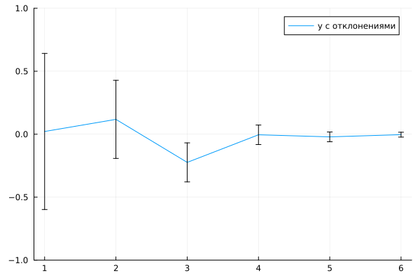{#fig-err-bar width=60%}

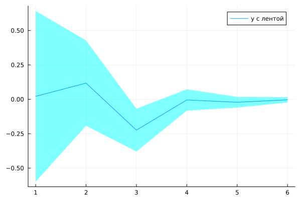{#fig-err-ribbon width=60%}

## 5.2.13. Гистограммы (пакет `Distributions`)

- Рис. -@fig-hist-rand — гистограмма случайных целых возрастов
  (равномерное распределение на $[15, 55]$).
- Рис. -@fig-hist-norm — гистограмма нормального распределения
  $\mathcal{N}(35, 10)$.
- Рис. -@fig-hist-mix — смесь трёх нормальных распределений
  $\mathcal{N}(10,5)$, $\mathcal{N}(35,10)$, $\mathcal{N}(60,5)$
  (50 корзин).

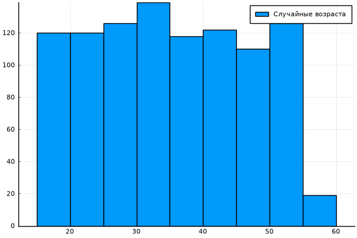{#fig-hist-rand width=65%}

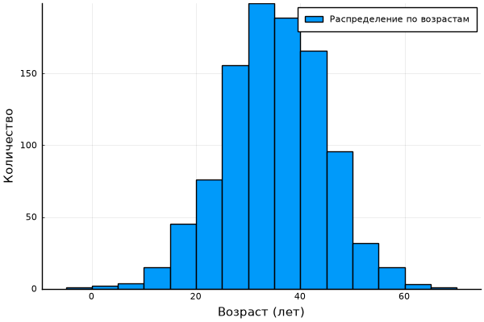{#fig-hist-norm width=65%}

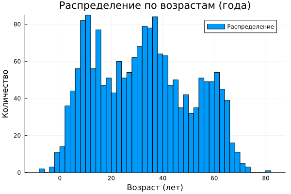{#fig-hist-mix width=70%}

## 5.2.14. Подграфики

- Рис. -@fig-lay-4x1 — четыре графика в столбец (`layout=(4,1)`).
- Рис. -@fig-lay-auto — автоматическая сетка (`layout=4`).
- Рис. -@fig-lay-heights — сетка с разной высотой панелей
  (`grid(4,1,heights=[...])`).
- Рис. -@fig-lay-comb — комбинированный график из четырёх разных
  типов (линия, точки, линии с заголовком, гистограмма).

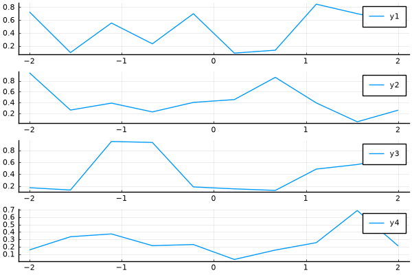{#fig-lay-4x1 width=65%}

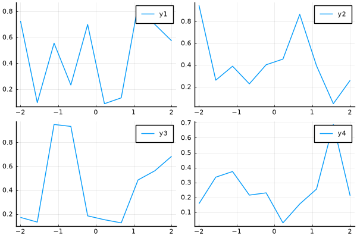{#fig-lay-auto width=65%}

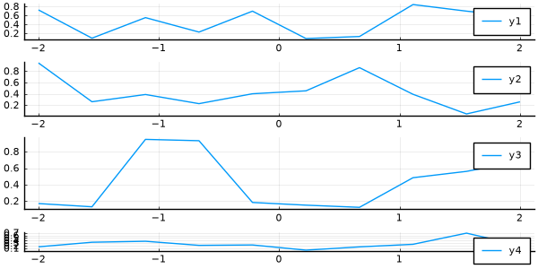{#fig-lay-heights width=65%}

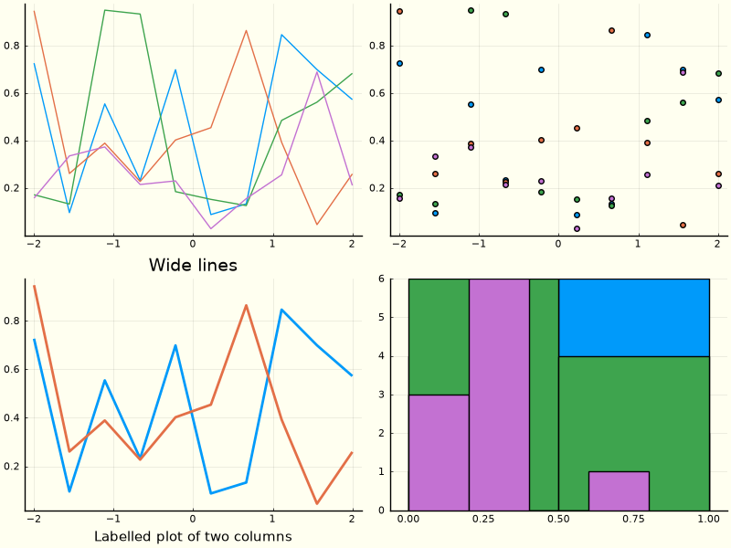{#fig-lay-comb width=80%}

## 5.4. Задания для самостоятельного выполнения

### Задания 1–2. Все типы графиков для $y = \sin x$ на $[0, 2\pi]$

На рис. -@fig-task12 показаны шесть типов представления одной и той
же функции: линия, точки, столбцы, гистограмма, ступени, «путь».
Видно, что `seriestype` полностью меняет способ визуализации данных
при одном и том же массиве значений.

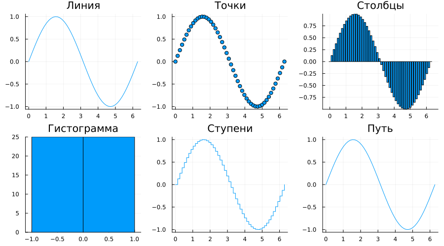{#fig-task12 width=90%}

### Задание 3. График $y = \pi x^2 \ln x$

На рис. -@fig-task3 — график с красной линией толщиной 3, светлым
фоном (`background_color=:ivory`), рамкой (`framestyle=:box`) и
заданными вручную делениями осей. Функция определена при $x>0$,
поэтому диапазон взят от $0.1$ до $10$.

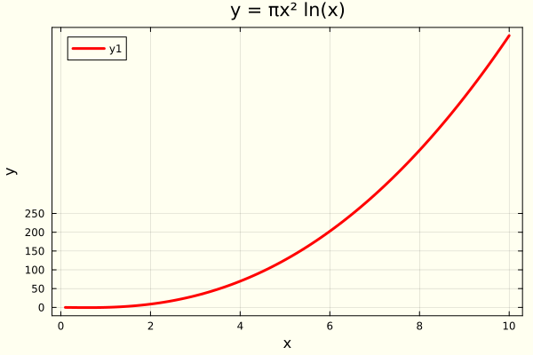{#fig-task3 width=65%}

### Задание 4. $y = x^3 - 3x$ в четырёх подграфиках

На рис. -@fig-familiya (файл `figure_familiya.png`) — четыре
представления: только точки, только линии, линии и точки, гладкая
кривая. Файл сохранён под именем, требуемым в задании.

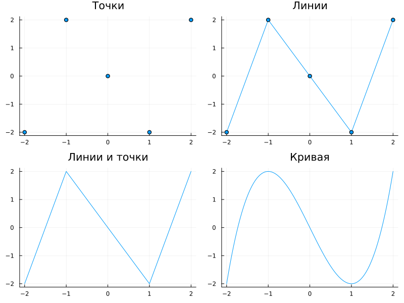{#fig-familiya width=80%}

### Задание 5. Две функции на одном графике и с двумя осями

На рис. -@fig-task5-single обе функции $y_1 = \pi x$ и
$y_2 = e^x\cos x$ построены на одной оси. **Недостаток:** масштабы
функций сильно различаются ($y_2$ растёт экспоненциально, $y_1$ —
линейно), поэтому на одном графике $y_1$ выглядит почти
горизонтальной линией. Решение — две оси ординат
(рис. -@fig-task5-twin).

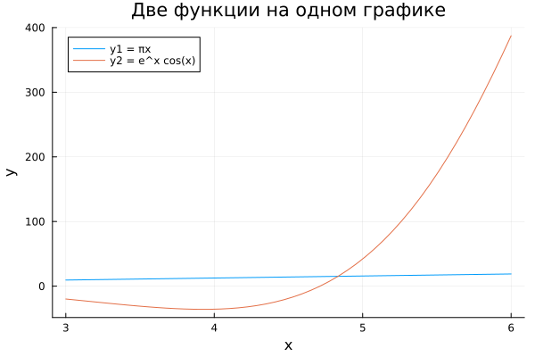{#fig-task5-single width=65%}

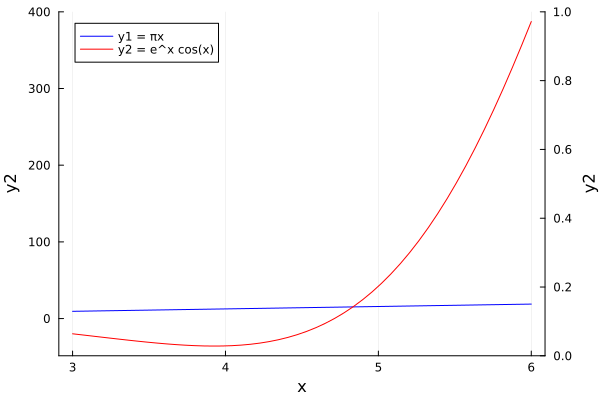{#fig-task5-twin width=65%}

### Задание 6. Экспериментальные данные с погрешностью

На рис. -@fig-task6 — точечный график $y = 5x + \text{шум}$ с
планками погрешностей `yerror`.

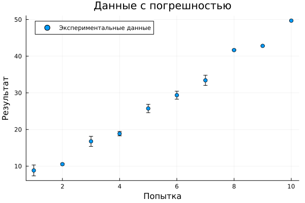{#fig-task6 width=65%}

### Задание 7. Точечный график случайных данных

На рис. -@fig-task7 — 50 случайных точек с подписями осей, легендой
и заголовком.

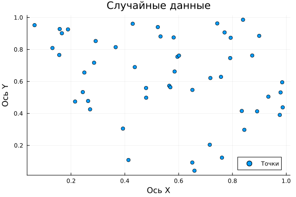{#fig-task7 width=65%}

### Задание 8. 3D точечный график случайных данных

На рис. -@fig-task8 — 50 случайных точек в трёхмерном пространстве
с подписями осей $X$, $Y$, $Z$, легендой и заголовком.

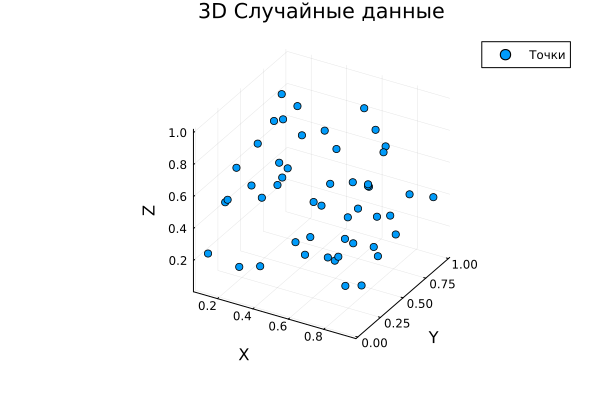{#fig-task8 width=65%}

### Задание 9. Анимация синусоиды

На рис. -@fig-task9 — GIF-анимация бегущей синусоиды
$\sin(x + t)$, где $t$ меняется от $0$ до $2\pi$ (50 кадров,
20 fps).

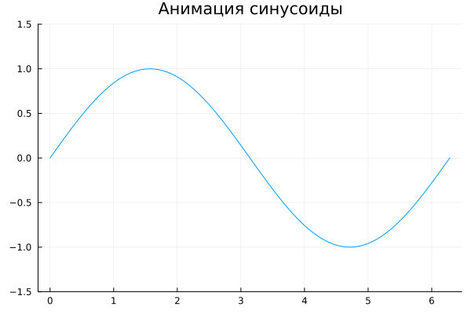{#fig-task9 width=65%}

### Задание 10. Анимация гипоциклоиды

На рис. -@fig-task10-pos и -@fig-task10-neg — две анимации
гипоциклоиды: для положительных $k \in [2.0, 2.5]$ и для
отрицательных $k \in [-2.5, -2.0]$. При отрицательных $k$ кривая
меняет ориентацию.

![Гипоциклоида, $k \in [2.0, 2.5]$](image/5_4_task_10_hypo_pos.gif){#fig-task10-pos width=60%}

![Гипоциклоида, $k \in [-2.5, -2.0]$](image/5_4_task_10_hypo_neg.gif){#fig-task10-neg width=60%}

### Задание 11. Анимация эпициклоиды

На рис. -@fig-task11-pos и -@fig-task11-neg — анимации
эпициклоиды для положительных и отрицательных $k$. По сравнению с
гипоциклоидой кривая «вытянута» наружу.

![Эпициклоида, $k \in [2.0, 2.5]$](image/5_4_task_11_epi_pos.gif){#fig-task11-pos width=60%}

![Эпициклоида, $k \in [-2.5, -2.0]$](image/5_4_task_11_epi_neg.gif){#fig-task11-neg width=60%}

# Обсуждение результатов

1. **Единый синтаксис, разные бэкенды.** Все примеры показали, что
   код `plot`/`scatter`/`surface` не зависит от выбранного бэкенда.
   Различия проявляются в поддержке кириллицы (PyPlot — лучше),
   интерактивности (PlotlyJS) и скорости/совместимости с GIF (GR).
2. **Поэлементные операции.** Для построения графика функции
   необходимо использовать broadcast-синтаксис (`x.^2`, `exp.(...)`),
   иначе Julia попытается выполнить матричные операции или выдаст
   ошибку. Это важное отличие от Matlab/Python-стиля.
3. **Аппроксимация.** Решение системы $A\vec{x}=\vec{y}$ через `\`
   даёт коэффициенты МНК-полинома. Полином 5-й степени хорошо
   описывает тренд, но не шум — это ожидаемо. Для более точной
   аппроксимации можно увеличить степень, но возрастёт риск
   переобучения (осцилляции на краях).
4. **Две оси ординат.** `twinx()` — корректный способ совместить
   траектории с разными масштабами. Без него одна из кривых
   «сплющивается» (рис. -@fig-task5-single).
5. **Анимации.** `@animate` + `gif()` работают стабильно с бэкендом
   GR. Для поверхностей анимация достигается изменением параметра
   внутри цикла; для кривых — постепенным увеличением длины
   массива $t$ (эффект «рисования»).
6. **Ограничения.** `PlotlyJS` при `savefig` требует Kaleido; в
   headless-окружении проще использовать GR или PyPlot. Поэтому в
   `lab5.jl` бэкенд `plotlyjs()` заменён на `gr()` для статичных
   изображений — это осознанное отклонение от методички,
   продиктованное средой выполнения.
7. **Практическая значимость.** Полученные навыки применимы для
   визуализации экспериментальных данных, численных экспериментов
   и подготовки иллюстраций к публикациям (PDF/PNG/GIF).

# Заключение

- **Цель достигнута:** освоен синтаксис `Plots.jl` для построения
  графиков; воспроизведены все примеры разделов 5.2.1–5.2.14 и
  выполнены задания 5.4.1–5.4.11.
- **Полученные результаты:** сгенерирован набор изображений
  (PNG, PDF, GIF) в папке `image/`; отчёт собран в формате Quarto
  Markdown с автоматическим включением сгенерированного из
  `lab5.jl` markdown-файла.
- **Выявленные особенности:** поэлементные операции обязательны;
  выбор бэкенда влияет на поддержку кириллицы и интерактивность;
  для GIF лучше подходит GR; `twinx()` решает проблему разных
  масштабов.
- **Направления развития:** освоить пакет `Makie.jl` для
  высокопроизводительной интерактивной визуализации; изучить
  `AlgebraOfGraphics.jl` для декларативного описания графиков;
  автоматизировать сборку отчёта через CI (GitHub Actions +
  Quarto).

# Список литературы {.unnumbered}

::: {#refs}
- JuliaLang. Plots.jl documentation. URL: https://docs.juliaplots.org/
- JuliaLang. Distributions.jl documentation. URL: https://juliastats.org/Distributions.jl/
- Quarto documentation. URL: https://quarto.org/docs/
- Literate.jl documentation. URL: https://fredrikekre.github.io/Literate.jl/
- Методические указания к лабораторной работе № 5 «Построение графиков».
:::

\appendix