# Лабораторная работа №2: Средства параллелизации OpenMP на основе редукции

## Цель работы
Изучение средств параллелизации стандарта OpenMP, основанных на редукции (свертке), а также реализация параллельных алгоритмов для работы с массивами и численного интегрирования.


## Задание 1. Редукция массивов (сумма, минимум, максимум)

**Реализация:**
В модуле `reduction.f90` были реализованы функции `omp_sum`, `omp_max` и `omp_min`. 
Для распараллеливания циклов использовалась директива `!$omp parallel do` с соответствующими операторами редукции.

Ключевой фрагмент реализации для функции суммирования:
```fortran
S = 0.0_real64
call omp_set_num_threads(ths_num)
!$omp parallel do reduction(+:S)
do i = 1, length
  S = S + A(i)
end do
!$omp end parallel do
```

Для поиска максимума и минимума используются аналогичные директивы `reduction(max:M)` и `reduction(min:M)`. Переменная `M` инициализируется первым элементом массива `A(1)`, после чего каждый поток ищет свой локальный экстремум, а OpenMP на этапе синхронизации выбирает глобальный.

*   `reduction(+:S)` — для нахождения суммы элементов массива.
*   `reduction(max:M)` — для нахождения максимального элемента.
*   `reduction(min:M)` — для нахождения минимального элемента.

Количество потоков задавалось через вызов `omp_set_num_threads(ths_num)`.

**Результаты тестирования:**
Тестовая программа `test_reduction` запускалась для массивов размером \(10^8\) элементов. Замеры проводились для 1–8 потоков с усреднением по 10 итерациям (алгоритм on-line average). 
По результатам замеров скриптом `plot.py` были построены графики зависимости времени выполнения от числа потоков для каждой функции.

### Графики для функции суммирования (omp_sum)
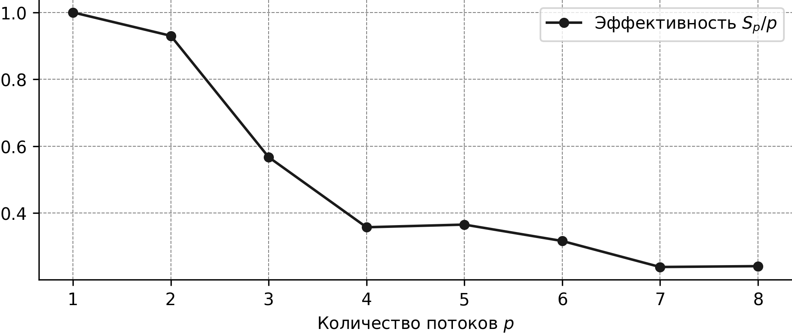
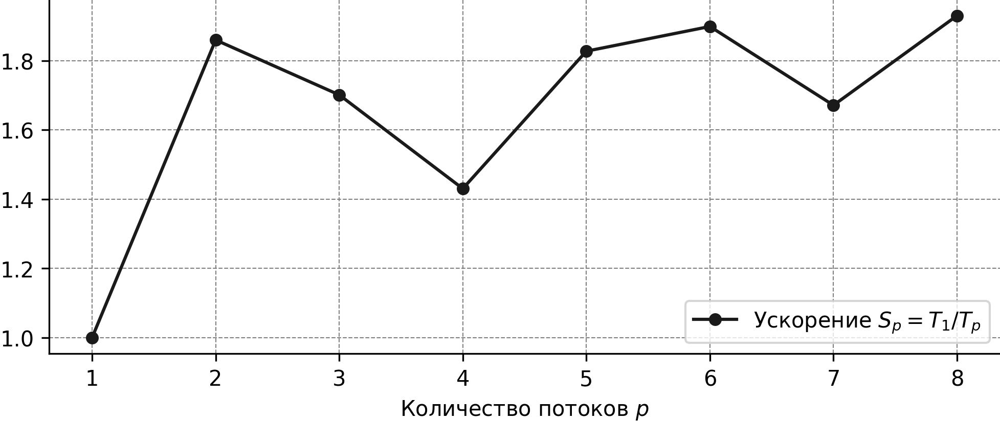
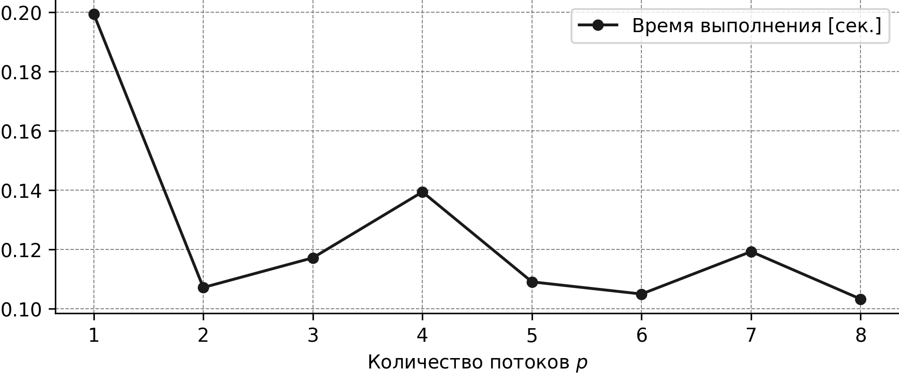

### Графики для функции поиска максимума (omp_max)
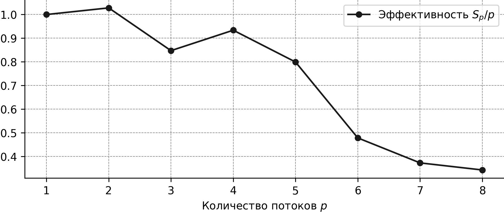
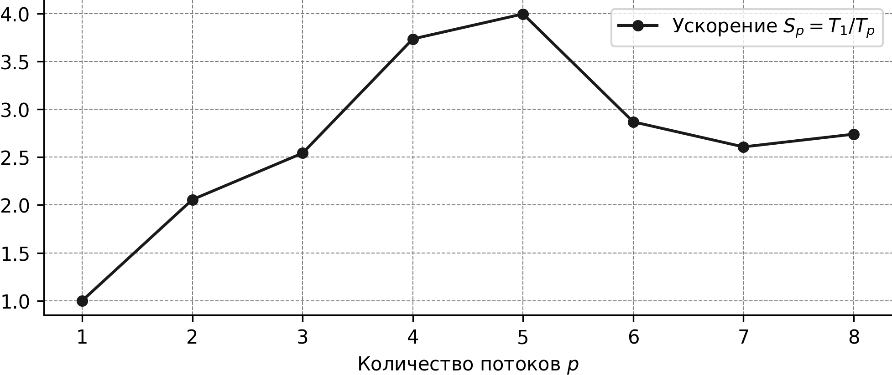
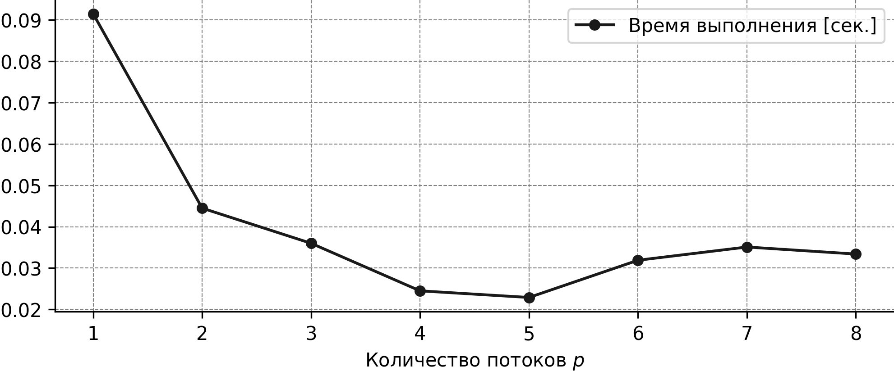

### Графики для функции поиска минимума (omp_min)
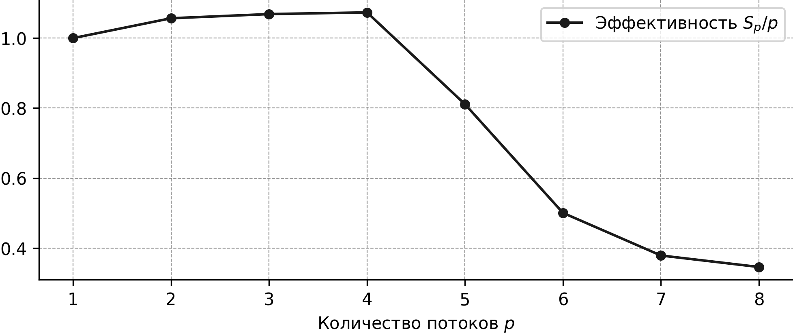
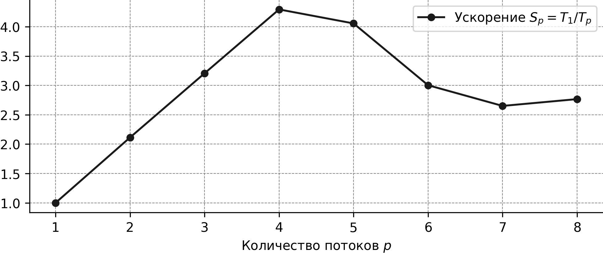
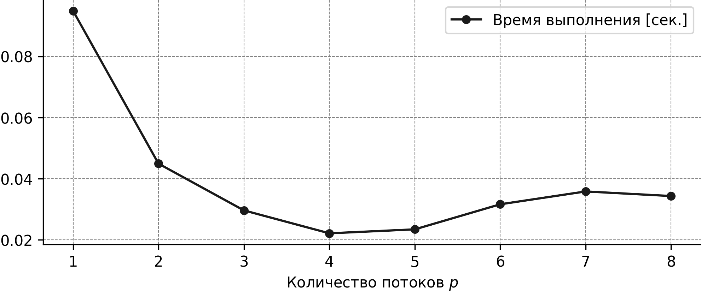


Наблюдается снижение времени выполнения при увеличении числа потоков, что подтверждает эффективность распараллеливания.


## Задание 2. Метод трапеций

**Реализация:**
В модуле `trapezoidal_rule.f90` была реализована функция `trapezoidal`, вычисляющая интеграл по формуле:
\[
 \int_a^b f(x) \, dx \approx \frac{h}{2}(f(a) + f(b)) + \sum_{i=1}^{n-1} f(x_i)h, \quad h = \frac{b-a}{n} 
\]
Цикл суммирования внутренних точек распараллелен с помощью `!$omp parallel do reduction(+:local_sum)`. Переменная `x` объявлена как `private`, чтобы каждый поток использовал своё значение.

Ключевой фрагмент реализации:
```fortran
h = (b - a) / real(n, real64)
local_sum = 0.0_real64
call omp_set_num_threads(ths_num)

!$omp parallel do reduction(+:local_sum) private(x)
do i = 1, n - 1
  x = a + real(i, real64) * h
  local_sum = local_sum + f(x)
end do
!$omp end parallel do

integral = (h / 2.0_real64) * (f(a) + f(b)) + local_sum * h
```
Крайние точки \(f(a)\) и \(f(b)\) вычисляются вне параллельного блока, так как они входят в формулу с коэффициентом \(h/2\), а не \(h\).

В ходе работы была исправлена ошибка несоответствия типов (передача `INTEGER(8)` в аргумент `INTEGER(4)`), путём изменения типа аргумента `ths_num` на `integer(int64)`.

**Результаты тестирования:**
Программа `test_trapezoidal` запускалась для различного числа разбиений и потоков. Построены графики ускорения и эффективности. 

### Графики для метода трапеций
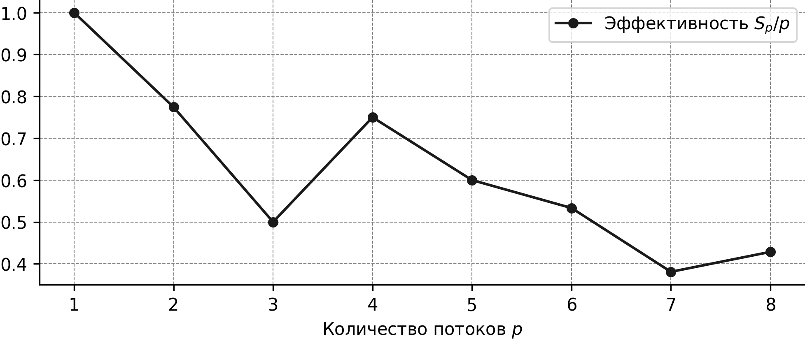
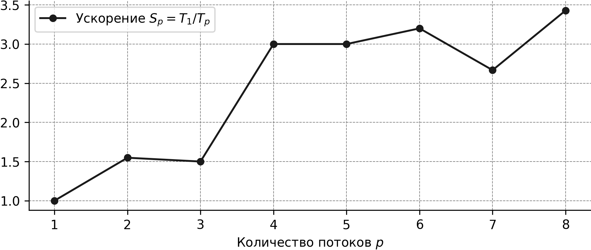
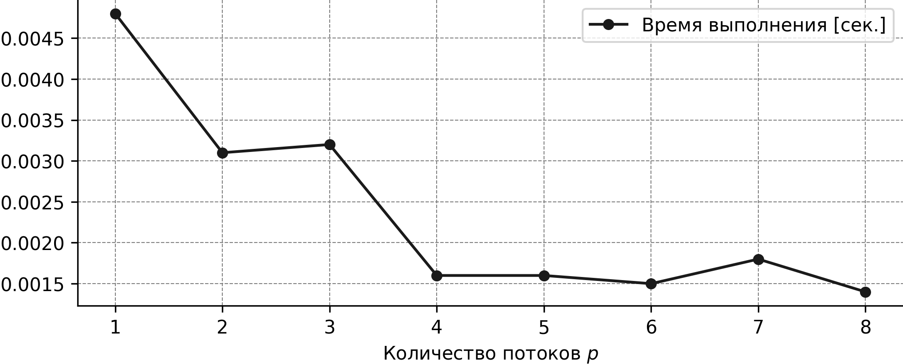

С ростом числа потоков время вычисления интеграла уменьшается, однако при большом числе потоков начинают сказываться накладные расходы на создание потоков и синхронизацию.


## Выводы
В ходе лабораторной работы были освоены механизмы редукции в OpenMP для Fortran. Реализованы параллельные алгоритмы поиска суммы, минимума и максимума элементов массива, а также численного интегрирования методом трапеций. Экспериментально подтверждено, что использование OpenMP позволяет сократить время выполнения ресурсоёмких вычислений пропорционально количеству доступных потоков (с учётом накладных расходов).
